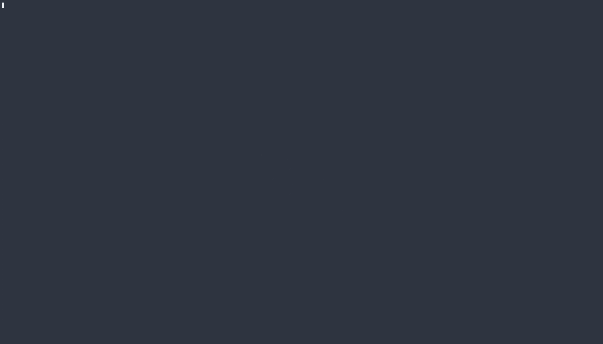

# lgtm.nvim

Review your branch's PR diff without leaving the editor — and fix things while
you're in there.



- **Edit in place.** The right-hand pane is the real working-tree file, not a
  copy. See a problem, fix it, `:w`, keep reviewing. The diff updates as you
  save.
- **AI comments, on demand.** Toggle in a third column of per-change notes,
  written by an agent that read the whole repository — not just the diff.
- **GitHub-style review flow.** PR description, changed-file tree, viewed
  ticks that persist across sessions, generated files pre-ticked and out of
  your way.

## Installation

With [lazy.nvim](https://github.com/folke/lazy.nvim):

```lua
{
    "simonhkswan/lgtm.nvim",
    dependencies = {
        "nvim-tree/nvim-web-devicons",       -- optional: file icons in the tree
        "nvim-telescope/telescope.nvim",     -- optional: only for :LgtmPick
    },
    cmd = { "LgtmEdit", "LgtmClose", "LgtmPick", "LgtmPr", "LgtmExplain", "LgtmAsk" },
    keys = { { "<leader>gd", "<cmd>LgtmEdit<CR>", desc = "PR diff review" } },
    config = function()
        require("lgtm").setup({})
    end,
}
```

Requires Neovim 0.10+ and `git`. Optional: `gh` detects the PR's target branch
and fetches its description; `claude` powers the AI comments column.

## The review view

```
:LgtmEdit
```

Opens a tab with the PR description and file tree on the left, then the file
as it is on the target branch (read-only), then the real file on disk
(editable):

```
┌──────────────────┬──────────────────┬──────────────────┬───────────────────┐
│ #19624 ENG-9436… │                  │                  │                   │
│ open · → dev     │ BASE (read-only) │ WORKING          │ AI COMMENTS       │
│ +4997 −370       │ the file as it   │ (editable)       │ (on demand)       │
├──────────────────┤ is on the PR     │ the real file on │ per-hunk notes    │
│ changed files    │ target branch    │ disk — edit, :w  │ from an agent     │
│  81 files        │                  │                  │ that read the     │
│  12/81 viewed    │                  │                  │ repo              │
└──────────────────┴──────────────────┴──────────────────┴───────────────────┘
```

Diff highlighting, alignment and scroll locking all come from Vim's built-in
diff mode. The comparison is against the **merge base** — the same diff GitHub
shows on the PR — and against the **working tree**, so uncommitted edits show
up too.

The target branch is detected from the PR via `gh`, and falls back to your
config, `origin/HEAD`, then `origin/dev`/`origin/main`/`origin/master`. Or
pass one explicitly: `:LgtmEdit origin/release-2`.

### Keys

| Key | Where | Action |
|---|---|---|
| `m` / `n` | any pane | next / previous changed file |
| `<PageDown>` / `<PageUp>` | any pane | same, alternate binding |
| `M` / `N` | any pane | next / previous chapter of work |
| `<S-PageDown>` / `<S-PageUp>` | any pane | same, alternate binding |
| `]C` / `[C` | any pane | next / previous commit (ALL → first → … → last) |
| `<leader>gy` | any pane | approve the selected commit — advances to the next unapproved one |
| `a` | commit picker | approve the commit under the cursor |
| `<End>` | any pane | toggle viewed — ticking advances to the next file |
| `<leader>ge` | any pane | toggle the AI comments column |
| `<leader>gw` | any pane | pick AI reviewers (one or many) |
| `<leader>ga` | diff panes | ask the AI about the hunk under the cursor, or the selected lines |
| `]c` / `[c` | diff panes | next / previous hunk (Vim built-in) |
| `<CR>` | tree | open file, or fold a directory |
| `v` | tree | toggle viewed |
| `q` | tree | close the session |

All bindings are buffer-local to the session's panes and configurable through
`keys`. Note that `m`/`n` shadow Vim's search-repeat inside those panes; rebind
them (for example back to `]f`/`[f`) if that matters to you.

Viewed ticks persist per branch, so a half-finished review resumes where you
left it. Ticks are dropped for files that changed after you ticked them.
Generated files (`-diff` / `linguist-generated` in `.gitattributes`) come
pre-ticked, as on GitHub.

### Commit by commit

The **COMMITS** pane above the file tree lists the branch's commits, oldest
first. `<CR>` on one (or `]C` / `[C` from anywhere) narrows the review to that
commit: the tree holds only its files, BASE shows each file at the commit's
parent, the right pane shows it as the commit left it (read-only), and the
description pane carries the commit message. The tip commit keeps the editable
working file, so its diff also includes any uncommitted edits. `ALL` returns to
the whole branch.

Viewed ticks are kept per commit, separately from the branch's own; a commit
whose files are all ticked gets a ✓ in the picker. Approving a commit
(`<leader>gy`) marks it ✔ and moves on to the next unapproved one.

Approvals and per-commit ticks are keyed by `git patch-id`, not the sha, so
they survive rebases, reorders and amends to *other* commits. When a commit's
own change moves, its approval lapses and it comes back for review.

The AI columns explain the branch as a whole, so they are only available with
`ALL` selected.

## The AI comments column


```
:LgtmExplain          toggle           <leader>ge
:LgtmExplain!         regenerate just the file you are on
```

One block per change region, aligned with the diff and scrolling with it:

```
┌────────────────────────────┬──────────────────────────────────────┐
│  def build_name(idx):      │  ▌ 120–134   +15 −3                  │
│ -    return f"IMG {idx}"   │  Move the naming rule out of the walk│
│ +    return allocate(idx)  │    Both editors walked the document  │
│                            │    and formatted the label inline;   │
│                            │    `image-name-allocation.ts` is now │
│                            │    the single statement of the rule. │
│  def walk(doc):            │                                      │
│      for node in doc:      │  ▌ 402   +1 −1                       │
│ -        n = build_name(i) │    ↑ one change with 120–134         │
└────────────────────────────┴──────────────────────────────────────┘
```

The work is phased. A fast first run reads the PR and writes a reviewer guide:
the change split into **chapters** of work, each with a one-line title, a
summary, and the files it touches. Then one run per chapter — in parallel —
explains that chapter's files, each agent given its chapter and its files'
diffs directly, with the whole repository readable behind them. Files no
chapter claimed get a final run of their own. Small prompts, comments written
with their chapter in view, and the file you have open is done first.

Results land a file at a time and are cached per branch, so a second session
costs nothing. Every agent runs with write access **denied inside your
repository**, so nothing can touch your working tree. The notes explain what
each change does against the full branch diff — never commit archaeology.

Nothing runs until you toggle the column in; plenty of reviews do not want
model calls at all.

### The chapter picker

A chapter picker opens as its own pane between the PR description and the file
tree, showing `planning chapters…` until the guide run delivers. The picker
comes and goes with the comments column — one `<leader>ge` toggles the pair,
and toggling off drops any chapter filter back to all files:

```
│ 󰙴 CHAPTERS                           │
│ ● ALL                                │
│   Cross-editor IMG. N allocation     │
│     0/4 viewed  ·  +435 −0           │
│   E2E coverage for inline images     │
│     2/3 viewed  ·  +118 −6           │
```

Both AI panes — the picker and the comments column — carry a `󰙴` header, so
generated content is labelled at a glance.

`<CR>` on a chapter narrows the file tree — and paging, and the viewed-advance —
to that chapter's files, and the description pane swaps to the chapter's summary.
"ALL" restores the full tree and the PR body. A file can belong to
several chapters or to none, and the guide is cached with the explanations, so
it is there instantly on the next session.

## The AI review column

```
:LgtmReview              pick reviewers from a checklist    <leader>gw
:LgtmReview security ai  run those reviewers directly
:LgtmReviewClose         close the review column
```

A panel of specialist reviewers — review-backend, review-frontend,
review-security, review-ai, review-code-quality, review-ai-slop, review-tests,
review-architecture — each with its own serious brief and a shared
reference-manual house style. `<leader>gw` opens a checklist: tick one or many
(`<Space>` toggles, `a` marks all, `<CR>` launches), and each ticked role
reviews the **selected chapter** — or the whole change on "ALL" — as its own
parallel run.

Findings attach to the same diff regions as the explanations and render in a
fifth column, right of the AI comments (or right of the working file when that
column is closed). Every role writes in its own colour, and a legend window at
the bottom of the column is the key:

```
│ 󰙴 REVIEW                        │
│  ▌ 120–134                      │
│   SQL built by string        │
│    concatenation                │
│    `build_query` interpolates…  │
│                                 │
│   no test for the new        │
│    fallback branch              │
├─────────────────────────────────┤
│  ● review-security              │
│  ● review-tests                 │
└─────────────────────────────────┘
```

Comments carry no role prefix — the colour is the byline, and the legend is
the key. The file tree carries the same colours: a file with findings gets one
dot per reviewer role after its name, so the files worth a closer look stand
out before you open them. Each finding leads with a severity icon in the theme's diagnostic
colours:  risk (can break production),  warn (should be fixed),
 info (the author may decline). A reviewer with nothing to say writes nothing — silent regions stay blank, and
an empty review is a valid review. Findings are cached with the explanations,
per branch. The review column has its own lifecycle: it stays up when
`<leader>ge` closes the comments column, and closes with `:LgtmReviewClose` or
the session.

## Asking about a hunk

```
<leader>ga              ask about the hunk under the cursor
V … <leader>ga          ask about the selected lines
:LgtmAsk [question]     the same, from the command line (takes a range)
```

The question box is a small float that wraps and takes several lines: type,
`<C-s>` sends (or `<CR>` from normal mode), `<Esc><Esc>` cancels. The answer
opens in a float. The agent is given the pull
request, the file's diff, the selected lines as they stand in the working tree,
the explanation the comments column wrote for that change, and any findings the
review panel raised on it — so the question can be about the code, about the
explanation, or about a reviewer's comment, and the answer is judged against all
three with the repository readable behind it.

```
┌ 󰙴 ASK — image_names.py:120–134 ───────────────────────────────────┐
│ ▌ is the security finding here real, or does the caller validate? │
│                                                                   │
│   The finding stands. `allocate_name` is called from …            │
│                                                                   │
│   1 explanation · 2 findings in hand   ·   <leader>ga follow-up · q close │
└───────────────────────────────────────────────────────────────────┘
```

Inside the float, `<leader>ga` (or `a`) asks a follow-up in the same thread: the
agent session is resumed, so it remembers the hunk and what it already said.
Each new `<leader>ga` from the diff starts a fresh thread. `q` closes the float.
The prompt line says what is in hand — `(+explanation, 2 findings)` — before you
type.

## Picking a branch


```
:LgtmPick
```

A Telescope picker over your local branches, with the PR description and the
branch's changed files (with your viewed progress) previewed beside it.
`<CR>` opens the review — in the branch's worktree if it has one, otherwise
checking it out where you are. It refuses rather than touching uncommitted
work.

## Reviewing a PR that is not local yet

```
:LgtmPr 1234      fetch that PR's branch and open the review
:LgtmPr           pick from the repository's open PRs
```

For when someone asks "can you check my branch?". The bare form lists open
PRs, newest first (up to `pr_limit`, 1000 by default), searchable by number,
title, branch, and author, with the PR body as the preview; either form runs
`gh pr checkout` — fork PRs included — and opens the review. Requires `gh`, refuses over uncommitted work, and reuses an
existing worktree or checkout when the branch is already local.

## Options

```lua
require("lgtm").setup({
    base_branch = nil,          -- fallback when there's no PR and origin/HEAD is unset
    tree_width = 60,            -- width of the left column
    desc_height = 0.45,         -- fraction of it given to the PR description
    base_width = nil,           -- fixed width for the base pane; nil splits evenly
    include_untracked = false,  -- also show files git does not know about yet
    advance = "next",           -- after ticking: "next" | "next_unviewed" | "none"
    generated = "skip",         -- "skip" pre-ticks generated files; "show" doesn't
    ruler = true,               -- change-position strip on the working pane's edge
    explain = {                 -- the AI comments column
        width = 76,
        cmd = { "claude" },     -- argv prefix; the headless flags are added
        model = "sonnet",       -- "" omits --model
        max_parallel = 3,       -- chapter runs in flight at once
        timeout = 1800000,      -- per run; a chapter is a fraction of the PR
    },
    ask = {                     -- asking about a hunk
        model = nil,            -- nil uses explain.model
        width = 100,            -- the answer float
    },
    diff_colors = {},           -- calmer diff tints derived from your theme;
                                -- false keeps the colourscheme's own colours
    keys = { ... },             -- see defaults in lua/lgtm/init.lua
})
```

The full option set, including the AI agent's tool allow-list and the diff
colour tuning knobs, is documented in `lua/lgtm/init.lua`.

Set `LGTM_NO_GH=1` to skip the `gh` lookup entirely.
